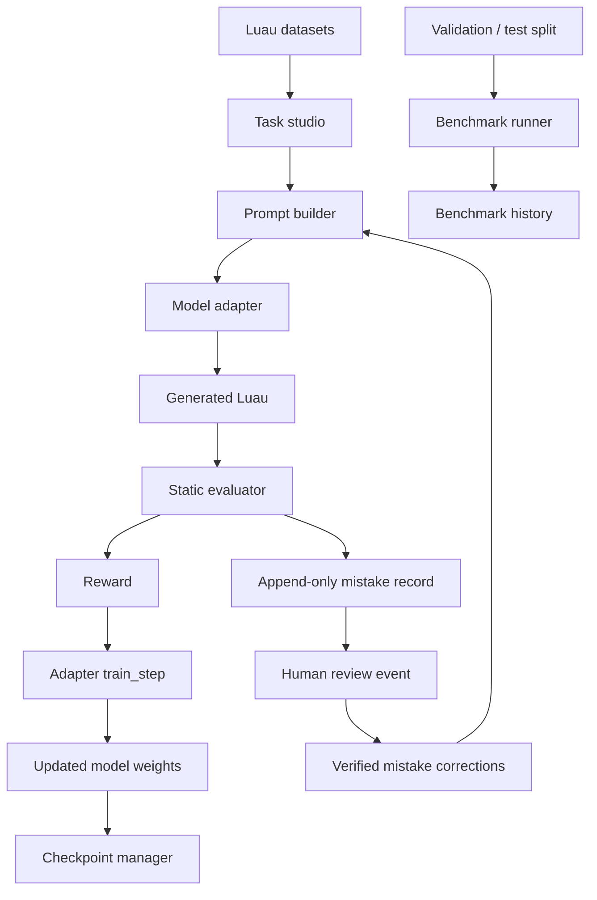

# Architecture

## Components

- **Dashboard:** static HTML/CSS/JavaScript. It calls the FastAPI JSON API.
- **API and orchestration:** `backend/main.py` handles imports, task management, evaluation, review events, training runs and checkpoints.
- **Persistence:** SQLite stores datasets, tasks, mistake records, review events, runs, benchmark results, adapter settings and checkpoint metadata. A JSONL audit file is appended under `data/mistakes/`.
- **Adapter boundary:** the lab calls a model through a small Python interface. The model itself remains yours.
- **Optional HF adapter:** `backend/hf_adapter.py` loads a local Transformers causal language model and performs a REINFORCE-style update.

## Data flow

## Persistence rules

- Dataset examples are stored as imported.
- Tasks can be disabled without deletion.
- Mistake attempts are immutable. Review decisions are separate append-only events.
- A correction is included in future prompts only when its latest review event is `verified`.
- Training runs record status, episode count, average reward, success heuristic rate, update count and average loss.
- A checkpoint is labelled `model_weights` only when the adapter actually saves weights. Otherwise it is marked `metadata_only`.

## Adapter contract

See `adapters/custom_adapter.py`. The training service calls:

- `generate(prompt, context)`
- `train_step(batch)`
- `save_checkpoint(path)`
- `load_checkpoint(path)`

The batch passed to `train_step` is a list of objects containing prompt, completion, reward and task ID. Reward is currently in the approximate range -1 to +1.
