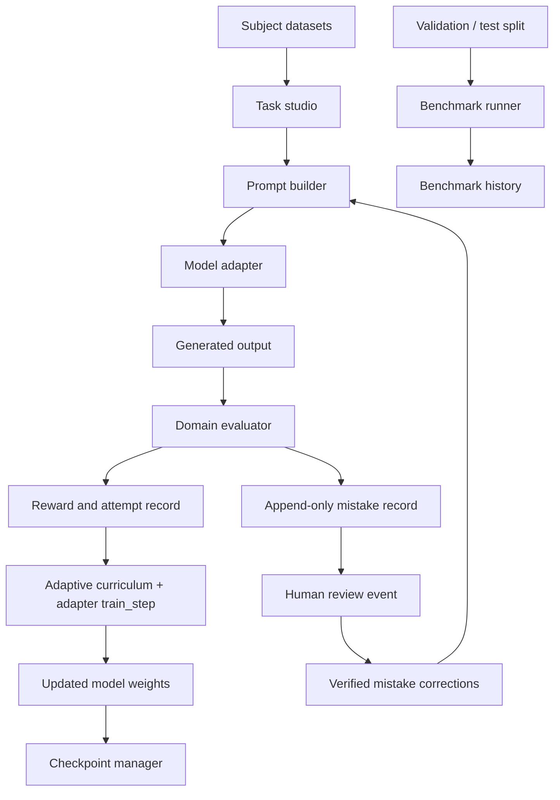

# Architecture

## Components

- **Dashboard:** static HTML/CSS/JavaScript. It calls the FastAPI JSON API.
- **API and orchestration:** `backend/main.py` handles imports, task management, evaluation, review events, training runs and checkpoints.
- **Persistence:** SQLite stores datasets, tasks, mistake records, review events, runs, benchmark results, immutable task attempts, human ratings, feedback-consumption state, adapter settings and checkpoint metadata. A JSONL audit file is appended under `data/mistakes/`.
- **Adapter boundary:** the lab calls a model through a small Python interface. The model itself remains yours.
- **Optional HF adapter:** `backend/hf_adapter.py` loads a local Transformers causal language model, applies LoRA by default, performs supervised reference updates and REINFORCE-style reward updates.

## Data flow

## Persistence rules

- Dataset examples are stored as imported.
- Tasks can be disabled without deletion.
- Mistake attempts are immutable. Review decisions are separate append-only events.
- A correction is included in future prompts only when its latest review event is `verified`.
- Training runs record status, episode count, average reward, score pass rate, update count and average loss.
- Every task attempt is stored with its evaluator score and reward. Recent task scores adjust curriculum selection weights. Human ratings (1–5) become explicit rewards (-1 to +1), remain pending until a real reward update succeeds, and are then marked consumed. Deleting a task does not delete its attempt or feedback history.
- A checkpoint is labelled `model_weights` only when the adapter actually creates its checkpoint directory. Training runs create a pre-training recovery backup and, after at least one reported optimizer update, an automatic post-training checkpoint. A failed final save marks the run failed with an explicit error while preserving the pre-training backup.

## Adapter contract

See `adapters/custom_adapter.py`. The training service calls:

- `generate(prompt, context)`
- `train_step(batch)`
- `save_checkpoint(path)`
- `load_checkpoint(path)`

## Dataset and run inspection

- `GET /api/datasets/stats` reports split/category counts, duplicate-content groups, empty examples and content-length statistics.
- `GET /api/adapter/status` includes non-mutating model diagnostics when the adapter supplies them; `/api/adapter/test` generates a sample without changing weights.
- `GET /api/training/preview` checks whether enabled tasks, train examples and a model adapter are configured, and reports pending feedback and verified corrections. It does not load the model or guarantee that a run will succeed.
- Each run records `human_feedback_examples` and `feedback_updates` separately from its total `real_updates`.

## Human feedback loop

1. A task attempt receives a stable `attempt_id`.
2. A reviewer submits a 1–5 rating and optional notes/correction/evidence to `POST /api/attempts/{attempt_id}/feedback`.
3. Ratings map to rewards: 1 → -1, 2 → -0.5, 3 → 0, 4 → 0.5, 5 → 1.
4. The next training run replays up to 64 pending rated attempts through `train_step`.
5. Feedback is marked consumed only after the adapter reports a valid, positive update count. Failed updates leave feedback pending for retry.
6. Inspect pending and historical feedback with `GET /api/feedback`; inspect immutable attempts with `GET /api/attempts`.

The batch passed to `train_step` is a list of objects containing prompt, completion, reward and task ID. Reward is currently in the approximate range -1 to +1.
